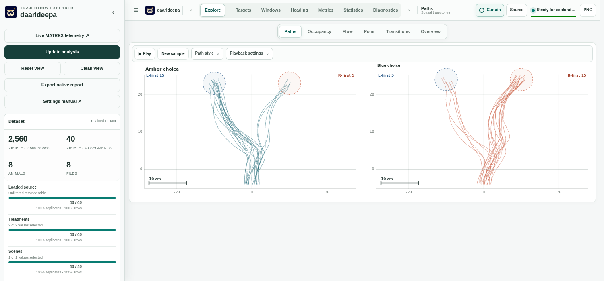

# daarideepa

**ದಾರಿದೀಪ** · a lamp for the path. Explore recorded animal trajectories, follow MATREX VR experiments live, or replay a saved run with Unity from the same local dashboard.

[Download a release](https://github.com/pvnkmrksk/daarideepa/releases/latest) · [Installation guide](docs/install.md) · [Settings manual](docs/manual.md) · [Cite this software](CITATION.cff)

## Start with the sample

1. Download the ZIP for your operating system from [GitHub Releases](https://github.com/pvnkmrksk/daarideepa/releases/latest). Extract the whole archive into one folder.
2. Open the launcher listed in the [installation guide](docs/install.md). It starts the dashboard in your browser at `http://127.0.0.1:8060/`. Keep the terminal open during use.
3. Choose **Source → Load sample**. The included synthetic recordings have two treatments and left/right targets. Try **Explore → Paths**, switch to **Occupancy** or **Flow**, or open **Targets** to see first-reach counts.

For your own data, choose **Source** and enter a CSV path, a folder, or a recursive glob on the computer running the dashboard. MATREX trajectory files can be read alongside their config JSON and animal metadata. See the [settings manual](docs/manual.md) for data columns, filters, view controls, recipes, and export options.

## Live experiments and recorded replay

- **Live** connects to MATREX VR telemetry. It shares the recorded workspace's plots, viewport, filters, and curtain controls, with live session and tracker diagnostics.
- **Recorded replay** can run in the explorer by itself or follow Unity's independent replay clock from the MATREX VR replay workspace. The dashboard plots the recorded tracks and can show the full path behind the current position.

See the [live telemetry guide](LIVE_TELEMETRY.md) for addresses, connection setup, and the [MATREX VR manual](https://pvnkmrksk.github.io/matrexVR/manual/) for rig configuration and playback. MATREX records the trajectory and stimulus metadata. [Rekkefly](https://github.com/pvnkmrksk/rekkefly) supplies flight tracking and [HejjéTrac](https://github.com/pvnkmrksk/hejjetrak) supplies treadmill tracking.

## Source and development

[Install from source](docs/install.md#install-from-source) · [Native architecture](NATIVE_ARCHITECTURE.md) · [Legacy Dash interface and pipeline](LEGACY_DASH.md) · [Build checks](https://github.com/pvnkmrksk/daarideepa/actions/workflows/native-build.yml)
